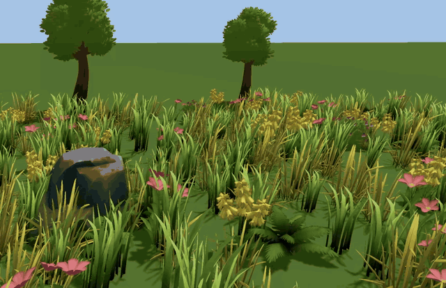

# viewport-lib-wind

Wind sway for [viewport-lib](https://github.com/grimandgreedy/viewport-lib) meshes: grass, foliage and banners ripple in a gusting breeze, driven by per-vertex displacement in the mesh shaders rather than a physics sim. The same field is sampled on the CPU, so spring bones, particles or cloth can follow the wind as well.

<p align="center">
  
</p>

## Examples

- **wind-meadow**: a meadow of grass, plants and trees swaying in the wind.
- **wind-minimal**: no window; samples the field on the CPU.

```sh
cargo run --release --example wind-meadow
```

## Versions

| viewport-lib-wind | viewport-lib |
| --- | --- |
| 0.2.0 | 0.23 |
| 0.1.0 | 0.19 |

## License

`viewport-lib-wind` is a part of the viewport-lib ecosystem.

GPL-3.0
